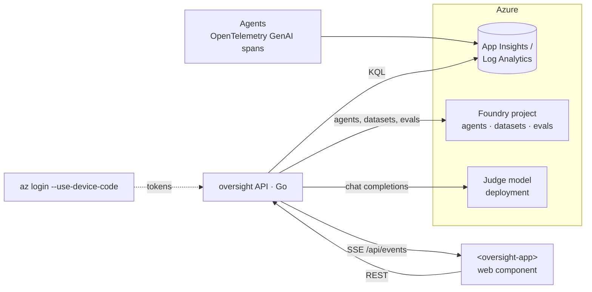

# Oversight

[](https://github.com/Lariat-Labs/oversightLLM/actions/workflows/ci.yml)

See what your Microsoft Foundry agents are doing, follow each run step by step,
let a judge model read intent from the logs, and turn real activity into eval cases that land in
Foundry's **Evaluations**.

- **API** (`api/`, Go, standard library only): reads agent telemetry from Application Insights,
  agents and evals from the Foundry project, and streams live updates over **SSE**.
- **Micro frontend** (`web/`, React + Vite): ships as a single web component, `<oversight-app>`,
  that any host page can embed.
- **Auth**: the Azure CLI. You sign in once with a **device code**, and the API reuses that
  session (`az account get-access-token`) for Foundry, Azure OpenAI and Log Analytics.



## Quick start

```bash
make setup   # tools check → device-code login → discover & write .env → verify access
make dev     # API on 127.0.0.1:8080 + frontend on :5180 (Ctrl-C stops both)
```

`make setup` finds the Foundry project, the Application Insights resource connected to it (its
Log Analytics workspace) and a model deployment for the judge. It writes them to `.env`, then checks
that each one answers. Run `make login` to force a new device-code sign-in, and `make check`
to re-verify without prompts.

Other targets: `make release V=x.y.z`, `make version`, `make register-judge`, `make openapi`, `make build` (binary + bundle), `make serve` (built API that also serves the frontend at `/`),
`make test` (Go tests + TypeScript typecheck).

### Environment

| Variable | Required | Default | What it is |
|---|---|---|---|
| `FOUNDRY_PROJECT_ENDPOINT` | ✔ | | `https://<resource>.services.ai.azure.com/api/projects/<project>` |
| `LOG_ANALYTICS_WORKSPACE_ID` | ✔ | | Workspace GUID behind the App Insights resource your agents trace to |
| `JUDGE_MODEL_DEPLOYMENT` | ✔ | | Deployment the judge uses (e.g. `gpt-5-mini`) |
| `AZURE_TENANT_ID` / `AZURE_SUBSCRIPTION_ID` | | | Tenant for device-code login / subscription to select |
| `AZURE_OPENAI_ENDPOINT` | | derived | `https://<resource>.openai.azure.com/openai/v1` |
| `OVERSIGHT_EVAL_DEPLOYMENT` | | judge | Grader model for Foundry evals |
| `OVERSIGHT_PORT` | | `8080` | API port |
| `OVERSIGHT_HOST` | | `127.0.0.1` | Listen address. Local only by default, because the API has no auth of its own |
| `OVERSIGHT_AUTO_JUDGE` | | `false` | Initial state of the auto-judge switch (also toggled in the UI; the UI setting persists) |
| `OVERSIGHT_CORS_ORIGINS` | | `*` | Origins allowed to embed the frontend |
| `OVERSIGHT_POLL_INTERVAL` | | `15s` | How often new spans are pulled for the live stream |
| `OVERSIGHT_LOOKBACK` | | `168h` | Activity window kept in memory |
| `OVERSIGHT_MAX_SPANS` | | `5000` | Max spans per activity query |
| `OVERSIGHT_DATA_DIR` | | `./data` | Eval cases and judge cache (JSON files) |
| `OVERSIGHT_WEB_DIR` | | | Serve the built frontend from the API |
| `APPLICATIONINSIGHTS_CONNECTION_STRING` | | found by `make setup` | Traces the judge's own calls to App Insights |

**Roles your user needs:** *Azure AI User* on the Foundry project, *Log Analytics Reader* on the
workspace, and *Cognitive Services OpenAI User* on the Foundry resource (for the judge).

## What you get

| Screen | What it shows |
|---|---|
| **Overview** | Runs, tool calls, tool error rate, tokens and active agents, each with a trend line. Also: the judge's fleet summary (on demand), activity over time, live events, recent runs, tool usage, and agents with per-agent activity. Every view follows the global time picker. |
| **Search** | Every run as an event. Query with `field=value`, `!=`, `>`, `<`, `*` wildcards and free text (fields: agent, status, tool, user, model, stop, judged, category, id, turns, duration, tokens, errors). A histogram you can click to zoom, a fields sidebar with value counts (click a value to filter), and an event list or sortable table. |
| **Agents** | A sortable table of every Foundry agent: state, activity, runs, tool calls, error rate, tokens, average and p95 run time, last seen, eval cases. Agents that emit spans but aren't registered appear too. A panel describes the Oversight judge and its own call and token usage. |
| **Agent detail** | One agent's health, activity, judged outcomes and flags, tool usage, Foundry definition (all metadata), runs, evals and latest Foundry run, and the system instructions from its latest captured run. |
| **Run** | The **run timeline**, rebuilt from OpenTelemetry spans: user input, each model call and the tools it requested, tool results (expand to see SDK and HTTP sub-calls), and the answer. The model's private reasoning isn't in telemetry, so it isn't shown. A **trace waterfall** tab shows timing. The judge infers intent, direction and risk flags. |
| **Evals** | Cases per agent: suggest from activity, draft from a run, or write by hand. Approve or reject, then upload to Foundry. Shows Foundry eval runs with pass rates and report links. |

### The judge is a Foundry agent too

The judge runs inside the Oversight API and calls `JUDGE_MODEL_DEPLOYMENT` directly. It's registered in
Foundry as the external agent **`oversight-judge`** (`make register-judge`, or the button on **Agents**), and when
`APPLICATIONINSIGHTS_CONNECTION_STRING` is set (`make setup` finds it) each judge call is traced to App Insights as
`invoke_agent oversight-judge` with a child `chat` span. Those spans carry tokens, the task (`intent`,
`fleet_summary`, `eval_suggestions`) and what was judged (`oversight.subject.*`). So the judge shows up in Oversight
like any other agent. The auto-judge never judges the judge's own runs.

### How telemetry becomes "what agents are doing"

The API reads OpenTelemetry **GenAI** spans from `AppDependencies` (`gen_ai.operation.name` of
`invoke_agent`, `chat`, `execute_tool`; plus `gen_ai.agent.id`, `gen_ai.conversation.id`,
usage, input/output messages, and the agent gateway's `agw.*` attributes when present).
For a conversation it loads every span and log line in the traces that carry that id, including
untagged children such as `secsdk …` operations and outbound HTTP, and rebuilds the tree.

- A **task** is one run: conversation id + trace. Its status is `completed` or `failed`, from the
  closing `invoke_agent` span. A run with no closing span is `running` (activity in the last 10
  minutes) or `incomplete`.
- When a client wraps the run in its own `invoke_agent` span (for example Open WebUI), the
  outer span counts as context, so runs and tokens aren't counted twice.
- Log Analytics ingests a few minutes late. The poller re-reads a 10-minute overlap and
  de-duplicates by span id, so the live feed can lag by however long ingestion takes.

### How evals reach Foundry

There are two kinds, because they answer different questions:

| | Curated cases | Recent runs (traces) |
|---|---|---|
| What's graded | Cases you approved, each against its expected behavior and expected tools | The agent's real runs, read from its App Insights traces |
| Start it | **Upload to Foundry** (Evals page) | **Evaluate recent runs** (agent page or Evals page), over the time picker's range |
| Foundry objects | Dataset `oversight-<agent>-evals` (new version per upload) + eval `oversight-<agent>` + run | Eval `oversight-traces-<agent>` + run with data source `azure_ai_traces` for the agent's `gen_ai.agent.id` |
| Graders | intent resolution, meets expected behavior (label model), used expected tools (label model) | intent resolution, task adherence, tool call accuracy |
| Shown under the agent's **Evaluations** tab in Foundry | No. A JSONL run doesn't name an agent, and Foundry ignores the `agent_name` metadata | **Yes.** The data source names the agent |

Your agents are external, so Foundry can't call them to produce fresh answers. Curated cases are graded on the
response logged in each case's source run, and hand-written cases need a reference response pasted in.
Trace evals grade only runs whose spans record `gen_ai.input.messages` / `gen_ai.output.messages`; runs shown as
"input not captured" are skipped. The project's identity needs read access to the App Insights resource
(see Foundry's evaluation permissions).

### The judge is a Foundry agent too

The judge runs inside the Oversight API and calls `JUDGE_MODEL_DEPLOYMENT` directly. It's registered in
Foundry as the external agent **`oversight-judge`** (`make register-judge`, or the button on **Agents**), and when
`APPLICATIONINSIGHTS_CONNECTION_STRING` is set (`make setup` finds it) each judge call is traced to App Insights as
`invoke_agent oversight-judge` with a child `chat` span. Those spans carry tokens, the task (`intent`,
`fleet_summary`, `eval_suggestions`) and what was judged (`oversight.subject.*`). So the judge shows up in Oversight
like any other agent. The auto-judge never judges the judge's own runs.

### How telemetry becomes "what agents are doing"

The API reads OpenTelemetry **GenAI** spans from `AppDependencies` (`gen_ai.operation.name` of
`invoke_agent`, `chat`, `execute_tool`; plus `gen_ai.agent.id`, `gen_ai.conversation.id`,
usage, input/output messages, and the agent gateway's `agw.*` attributes when present).
For a conversation it loads every span and log line in the traces that carry that id, including
untagged children such as `secsdk …` operations and outbound HTTP, and rebuilds the tree.

- A **task** is one run: conversation id + trace. Its status is `completed` or `failed`, from the
  closing `invoke_agent` span. A run with no closing span is `running` (activity in the last 10
  minutes) or `incomplete`.
- When a client wraps the run in its own `invoke_agent` span (for example Open WebUI), the
  outer span counts as context, so runs and tokens aren't counted twice.
- Log Analytics ingests a few minutes late. The poller re-reads a 10-minute overlap and
  de-duplicates by span id, so the live feed can lag by however long ingestion takes.

### How evals reach Foundry

`POST /api/evals/upload` takes an agent's approved cases and:

1. uploads them as a JSONL **dataset**, `oversight-<agent>-evals` (new version each time);
2. creates the **eval** `oversight-<agent>` once (metadata `agent_name=<agent>`), with graders:
   `builtin.intent_resolution`, `meets_expected_behavior` (model label grader) and `used_expected_tools`;
3. starts an **eval run** and returns the run and its report link.

The agents are external (they run in the agent gateway), so Foundry can't call them. Each case is graded on
the response logged in its source conversation. Hand-written cases need a reference response pasted in.

### The judge: on demand, with an auto switch

By default the judge runs only when you ask: **Ask the judge** on the overview, opening a conversation,
or **Suggest from activity**. The **Auto-judge** switch in the top bar (or `OVERSIGHT_AUTO_JUDGE=true`)
judges each run as it finishes, one at a time, using the cached result when nothing changed. Runs judged
`drifting`, `stuck` or `failed` show up as **Judge alerts** on the overview. With the switch on, every
finished run costs one judge call.

## API

Interactive docs: **http://127.0.0.1:8080/api/docs** (Swagger UI). The spec is at `/api/openapi.json`, generated
from `scripts/gen_openapi.py` (`make openapi`). A test fails if a route is missing from the spec.

| Method | Path | Purpose |
|---|---|---|
| GET | `/api/health` | Azure CLI session, Foundry reachability, poller status |
| GET | `/api/events?agent=&conversation=` | **SSE**: `status`, `overview`, `activity`, `insight`, `intent`, `alert`, `settings`, `evals`, `evals.uploaded`, `heartbeat` |
| GET | `/api/overview?agent=&window=24h` | Totals, agents, tools, tasks, timeline, feed |
| GET/POST | `/api/overview/insight` | Latest / new judge summary of the fleet |
| GET/PUT | `/api/settings` | `{"autoJudge": true}`: the auto-judge switch |
| GET | `/api/alerts` | Runs the auto-judge marked drifting, stuck or failed |
| GET | `/api/judge` | Judge deployment, Foundry registration, tracing status, and call/token usage |
| POST | `/api/judge/register` | Register the judge in Foundry as external agent `oversight-judge` |
| GET | `/api/docs`, `/api/openapi.json` | Swagger UI and the OpenAPI 3.1 spec |
| GET | `/metrics` | Prometheus metrics for the service itself (see [Metrics](#metrics)) |
| GET | `/api/agents?window=`, `/api/agents/{id}?window=` | Foundry agents joined with telemetry (per-agent timeline, p95 run time) |
| GET | `/api/tasks?agent=&status=&window=&limit=` | Runs, with cached judge intent |
| GET | `/api/conversations/{id}` | Run timeline steps for a conversation |
| POST | `/api/conversations/{id}/intent[?force=1]` | Judge intent / direction / risk flags (cached) |
| GET | `/api/intents?agent=` | All judged intents |
| GET/POST | `/api/evals?agent=` | List / create cases |
| PUT/DELETE | `/api/evals/{id}` | Update (e.g. `{"status":"approved"}`) / delete |
| POST | `/api/evals/from-conversation/{id}` | Draft a regression case from a real run |
| POST | `/api/evals/suggest` | `{"agent","count"}`: judge proposes cases from recent activity |
| POST | `/api/evals/upload` | `{"agent","caseIds?"}`: dataset + eval + run in Foundry (curated cases) |
| POST | `/api/evals/traces` | `{"agent","lookbackHours?","maxTraces?"}`: grade the agent's recent runs from traces (shows under the agent in Foundry) |
| GET | `/api/evals/foundry?agent=` | Foundry evals and recent runs |

## Releases

The version lives in [`VERSION`](VERSION) and is stamped into the API binary (`oversight version`, `/api/health`,
`oversight_build_info`), the npm package and the OpenAPI spec.

```bash
make release V=0.2.0          # bump versions, regenerate the spec, run tests, commit, tag
git push origin main v0.2.0   # pushing the tag publishes the release
```

The [Release workflow](.github/workflows/release.yml) then runs CI and publishes:

- **GitHub Release** `vX.Y.Z` with `oversight_<version>_<os>_<arch>` archives for linux/darwin (amd64, arm64) and
  windows (amd64), plus `SHA256SUMS`. Each archive has the binary with the UI next to it, so `./oversight` serves the
  API and the UI on one port. Copy `.env.example` to `.env` (or run `scripts/setup.sh`) first.
- **npm package** [`@lariat-labs/oversight-element`](https://github.com/Lariat-Labs/oversightLLM/pkgs/npm/oversight-element)
  on GitHub Packages: the `<oversight-app>` web component for embedding in other apps.

Running the workflow by hand (Actions → Release → Run workflow) is a dry run: it builds everything and keeps the
archives as workflow artifacts, but publishes nothing.

## Metrics

`GET /metrics` serves Prometheus text format for **the Oversight service itself**. Fleet activity (runs,
tokens per agent) is already in App Insights and `/api/overview`, so it isn't repeated here.

| Metric | What it tells you |
|---|---|
| `oversight_http_requests_total{route,code}`, `oversight_http_request_duration_seconds{route}` | API traffic and latency by route pattern |
| `oversight_upstream_requests_total{service,outcome}`, `…_duration_seconds{service}` | Azure calls (foundry, openai, loganalytics, blob, appinsights): failures and slowness |
| `oversight_telemetry_polls_total{outcome}`, `oversight_telemetry_last_success_age_seconds`, `oversight_telemetry_spans_in_memory`, `oversight_telemetry_ready` | Whether the live view is actually current |
| `oversight_judge_calls_total{task,outcome}`, `oversight_judge_tokens_total{task,direction}`, `oversight_judge_call_duration_seconds{task}` | What the judge costs and how often it fails |
| `oversight_autojudge_enabled`, `oversight_autojudge_queue_depth`, `oversight_autojudge_alerts_total{status}`, `oversight_autojudge_skipped_total{reason}` | Auto-judge state, backlog and alerts |
| `oversight_eval_uploads_total{outcome}`, `oversight_eval_cases_uploaded_total`, `oversight_eval_cases{status}`, `oversight_eval_trace_runs_total{outcome}` | Eval curation, uploads, and trace eval runs in Foundry |
| `oversight_trace_export_spans_total{outcome}`, `oversight_judge_tracing_enabled` | Whether the judge's own traces reach App Insights |
| `oversight_sse_subscribers`, `oversight_uptime_seconds`, `oversight_build_info` | Connected UIs, uptime, version |

Useful alerts: `oversight_telemetry_last_success_age_seconds > 300` (the live view is stale) and
`rate(oversight_upstream_requests_total{outcome="error"}[5m]) > 0`.

## Embedding the micro frontend

```bash
npm install @lariat-labs/oversight-element --registry=https://npm.pkg.github.com   # then: import "@lariat-labs/oversight-element"
```

```html
<script type="module" src="https://<where-you-host>/oversight-element.js"></script>
<oversight-app api-base="https://<oversight-api>" theme="auto" agent="cve-triage"></oversight-app>
```

`make build` writes `web/dist/oversight-element.js` (one unhashed ES module, React included,
styles scoped in a shadow root). Attributes: `api-base`, `theme` (`light` | `dark` | `auto`), and
`agent` (initial filter), and `routing="hash"` (mirror the view in the URL so refresh and back work). Press ⌘K anywhere for the command palette. The element dispatches `oversight:navigate` with the current route so a
host can sync its URL. Allow the host's origin in `OVERSIGHT_CORS_ORIGINS`.

## Layout

```text
api/
  cmd/oversight/        entry point
  internal/config/      env + .env loading
  internal/azauth/      Azure CLI tokens (cached per resource)
  internal/insights/    Log Analytics query client
  internal/activity/    spans → tasks, overview, conversation chain (pure, tested)
  internal/foundry/     agents, datasets, evals, chat completions
  internal/judge/       intent, fleet summary, eval suggestions
  internal/evals/       case store + Foundry publishing (tested)
  internal/stream/      SSE hub
  internal/server/      HTTP routes, live poller, /metrics, OpenAPI docs
  internal/metrics/     Prometheus-format registry (no dependencies)
  internal/telemetry/   App Insights exporter for the judge's own spans
web/src/
  element.tsx           <oversight-app> custom element
  App.tsx, views/       Overview · Agents · Conversation · Evals
scripts/setup.sh        device-code login, discovery, verification
scripts/gen_openapi.py  source of the OpenAPI spec (make openapi)
```

## Known limits (MVP)

- State (eval cases, judge cache) lives in JSON files under `data/`, which is fine for one user. Use a database for a team.
- Single user by design: the API acts as whoever ran `az login`, has no auth of its own, and listens on 127.0.0.1.
- Alerts are kept in memory, so they reset when the API restarts.
- Message content shows only when agents record `gen_ai.input.messages` / `gen_ai.output.messages`.
  Runs without it show "(input not captured)".

## License

MIT. See [LICENSE](LICENSE).
